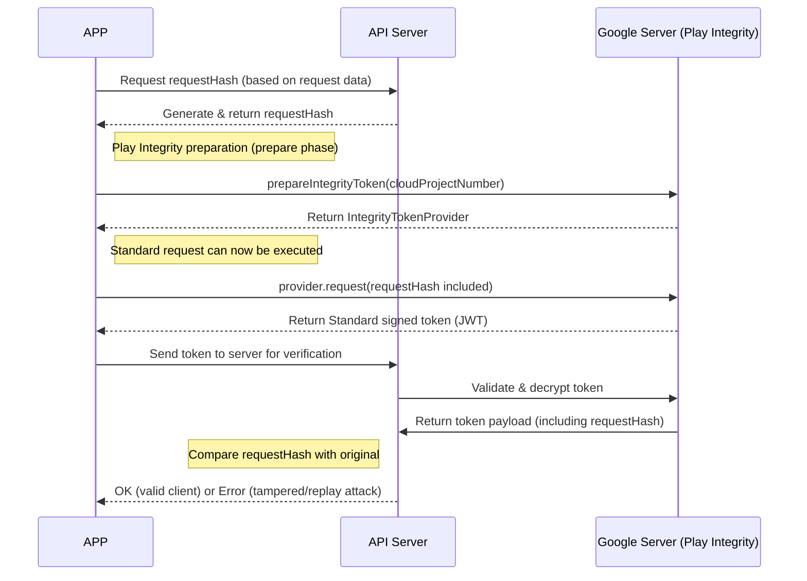
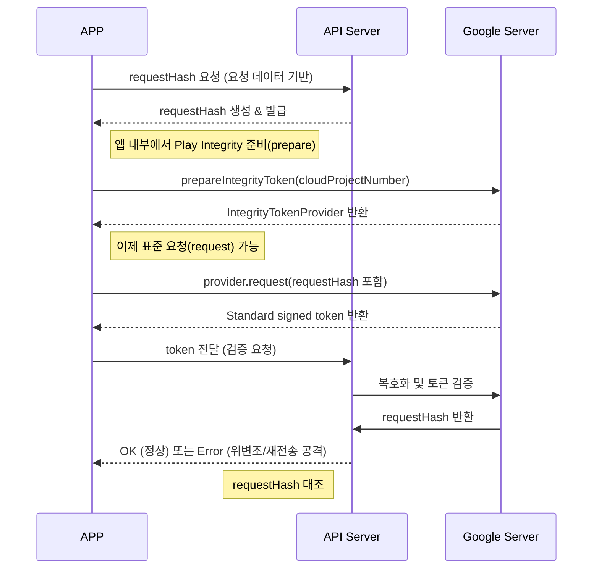

# App Device Integrity Plus

<details> <summary><strong>🇺🇸 English</strong></summary>

## Why?

### What This Fork Fixes

The original app_device_integrity had a critical issue:

- The challengeString (nonce) sent from Flutter was completely ignored.

- The plugin always used a static Base64.encode(ByteArray(40)) value.

- This produced the well-known "AAAAAAAAAAAA..." nonce in Play Integrity logs.

- Real server-side verification was not possible because the nonce never matched.
### Fixes in This Version

This fork fixes all of that.

- Proper nonce passthrough from Flutter → Native → Play Integrity

- Removed static dummy nonce (ByteArray(40))

- Added proper MethodChannel argument handling

- Updated API to accept challengeString exactly as given

- Real attestation with server-side validation now works

- README rewritten for clarity

- Additional flow diagram for easier understanding

<br>

## 🚀 How to Use

1) Request nonce from your backend

Your server must generate a unique challenge per session.
```dart
final sessionId = await api.getNonce();
```

2) Pass nonce into the plugin
```dart
final integrity = AppDeviceIntegrityPlus();

if (Platform.isAndroid) {
  final token = await integrity.getAttestationServiceSupport(
    challengeString: sessionId,
    gcp: 523725941100,
  );
} else {
  final token = await integrity.getAttestationServiceSupport(
    challengeString: sessionId,
  );
}
```

3) Send token to backend for validation

``` dart
await api.verifyIntegrity(token);
```
<br>


## 📊 Attestation Flow (App ↔ API Server ↔ Google)


## 📚 References
- https://developer.android.com/google/play/integrity/standard?hl=ko#java
- https://developer.android.com/google/play/integrity/overview?hl=ko
</details>

<details> <summary><strong>🇰🇷 한국어</strong></summary>

## 🔧 왜 만들게 되었는가?

### 원본 app_device_integrity 플러그인의 문제

- Integrity API의 기존방식 제공(레거시)
- Flutter에서 넘긴 challengeString(nonce)을 전혀 사용하지 않음
- 내부에서 항상 ByteArray(40) → Base64 인코딩한 값 사용
- 그래서 Play Integrity 로그에 "AAAAAAAAAA..." nonce만 출력됨
- 서버 검증 시 nonce 불일치 → 정상적인 보안 검증 불가능

### ✅ 이 버전에서 수정 / 개선된 내용
- Integrity API의 표준 방식으로 리펙터링

- 서버에서 받은 nonce를 그대로 Play Integrity에 전달

- 더 이상 static dummy nonce 사용하지 않음

- MethodChannel 파라미터 처리 수정

- Android/iOS에서 실제 nonce 기반 토큰 생성 가능

- README 전면 재작성

- 플로우 다이어그램 추가
<br>

## 🚀 사용 방법
1) 서버에서 nonce 발급
```dart
final sessionId = await api.getNonce();
```

2) 플러그인에 nonce 전달
```dart
final integrity = AppDeviceIntegrityPlus();

if (Platform.isAndroid) {
  final token = await integrity.getAttestationServiceSupport(
    challengeString: sessionId,
    gcp: 523725941100,
  );
} else {
  final token = await integrity.getAttestationServiceSupport(
    challengeString: sessionId,
  );
}
```

3) 토큰을 서버로 전달해 검증
```dart
await api.verifyIntegrity(token);
```
<br>

## 📊 전체 플로우 (앱 ↔ 서버 ↔ Google)

<br>

## 📚 참고
- https://developer.android.com/google/play/integrity/standard?hl=ko#java
- https://developer.android.com/google/play/integrity/overview?hl=ko
</details>